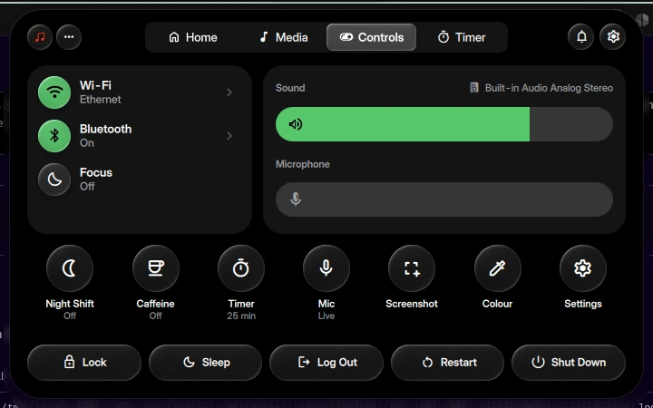

# Dynamic Island

A black island at the top of the screen that grows when something happens: a song starts, a timer runs, a notification arrives, you open the launcher. Click it for a small dashboard. The controls on it are liquid glass.

From [quickshell-DynamicIsland](https://github.com/Alan-Betty/quickshell-DynamicIsland) by Alan Betty, version 4.0.0.



## What it does

- **Live activities.** Music, timers, the stopwatch and shell recordings take over the pill. A second activity gets its own bubble and the clock steps out to the left.
- **Dashboard.** Home (clock, weather, calendar, system rings, now playing), Media, Controls (Wi-Fi and Bluetooth menus, sound, brightness, Night Shift, Caffeine, power) and Timer.
- **Notifications.** Banners drop from under the island. The Notification Center groups by app, and urgent banners stay a little longer, then tuck away.
- **Launcher.** Super+Space stretches the island into a search field: apps (the ones you use most first), sums, and `>` commands.
- **System tray.** Tray apps sit next to the tabs, and their menus open inside the island.

## How it fits Ryoku

Ryoku stays in charge of the desktop's services. The island draws on top of them:

- **Notifications.** The shell owns the daemon. With Allow Notifications on, the island takes each arrival out of the shell's toast queue and draws it, so exactly one banner shows. Do Not Disturb is the shell's Focus.
- **Launcher and Settings.** Super+Space and the settings key open the island's launcher and settings through the shell's surface bus.
- **Night Shift, Caffeine, session actions, screenshots, recording** go through `Nightlight`, `Flags.keepAwake`, `SessionActions`, `Capture` and `Recorder`.
- **Workspaces, focused output, fullscreen** come from the `Wm` facade. There is no compositor CLI anywhere, so the same bar style runs on Hyprland and niri.
- **Colours.** The accent follows the Ryoku palette first, then Matugen, Pywal or Wallust, the wallpaper, GTK, album art or a colour you pick.

Out of the box the island leaves volume and brightness pills to the shell's own OSD and keeps notification sounds off, because the shell already plays one. Both are switches in the island's settings.

## Shortcuts and IPC

The island registers `quickshell:islandLauncher`, `islandToggle`, `islandCenter`, `islandTray` and `islandSettings` through the global-shortcut protocol when the compositor offers it. Bind them in Ryoku Hub → Keybinds.

```sh
qs ipc call island toggle | center | tray | launcher | settings | playPause | clearBanners
qs ipc call island trayMenu <app>
```

## Settings

The gear on the island opens the island's own settings window. Everything applies live and is saved to `~/.config/ryoku/dynamic-island/settings.json`.

## What it runs, reads and writes

- **Runs:** `nmcli` (Wi-Fi), `brightnessctl`, `cava` (visualizer, if installed), `paplay` (sounds, off by default), `wl-copy` (maths results), `hyprpicker` (colour picker, if installed), `gsettings` (GTK accent), `curl` (weather, off by default), and a camera-in-use probe over `/proc` on machines with a camera.
- **Reads:** Matugen and Pywal colour files, the current wallpaper (only when it is the accent source), and GeoClue's demo client if present.
- **Writes:** its own `settings.json` and a small runtime file for cava's config.
- **Network:** nothing until you turn Weather on. Then Open-Meteo for the forecast, and in Automatic or IP Only mode ipinfo.io or ipapi.co for your position, with BigDataCloud for a place name. Manual location skips the lookups.
- **Privileges:** none.

`GlassControl.qml` draws the liquid glass with `shaders/liquidglass.frag.qsb`, a compiled Qt shader. Its GLSL source is `shaders/liquidglass.frag`.

## Limits

- The click-away doesn't use a compositor grab. While the island is open it covers the screen with an invisible layer, and the first click outside closes it rather than reaching the window underneath.
- Only shell-owned recordings show as a live activity.
- Inline reply needs the notification server to advertise it, and Ryoku's doesn't, so the reply field stays hidden. Actions still work.

## Maintenance

Maintained by Alan Betty at the upstream repository. Report problems there.

See `PROVENANCE.txt` for how this package is built from upstream.
