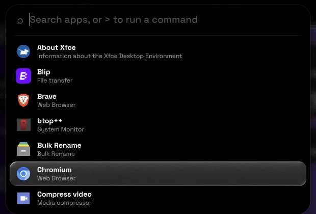

# Island

The Dynamic Island's launcher, for Super+Space on any Ryoku bar style.

A black pill drops from the top edge and stretches into a search field. The selected row is a slab of liquid glass that glides as you move.

- **Apps.** Fuzzy search over names, generic names, keywords and descriptions. The apps you open most rise to the top.
- **Sums.** Type `2*(3+4)` and the answer appears; Enter copies it.
- **Commands.** Start with `>` to run a command. Ctrl+Enter runs it in your terminal.

`↑` `↓` or `Tab` move, Enter opens, Esc or a click outside closes.

Install it from RyoStore → App launchers, pick it in Settings → App Launcher and save.

## What it runs, reads and writes

- **Runs:** the app you pick, through Ryoku's `AppLaunch`, so terminal apps open in your terminal. A `>` command runs exactly what you typed, through `sh -c`, inside `ryoku-app terminal` when you press Ctrl+Enter. Copying a sum runs `wl-copy`.
- **Writes:** launch counts, for the ranking, to `island-launcher.json` in the shell's state directory. Delete it to reset.
- **Network:** none.

No window manager in the code. The focused output comes from `Wm`.

`GlassControl.qml` draws the glass with `shaders/liquidglass.frag.qsb`, a compiled Qt shader. The GLSL source is next to it in `shaders/liquidglass.frag`.

From [quickshell-DynamicIsland](https://github.com/Alan-Betty/quickshell-DynamicIsland) by Alan Betty. MIT licensed. Report problems upstream.
