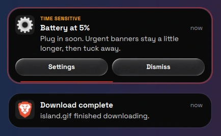

# Island

The Dynamic Island's notification card, for any Ryoku bar style.

A black card with the app icon, or the sender's picture with a small app badge, and the summary, body and time. Liquid glass appears only where your hand goes: the close bead on hover and the action pills. Urgent notifications get a "Time Sensitive" line and a red halo. A timed card drains a hairline along its foot. Persistent cards don't, because they aren't counting down.

Install it from RyoStore → Notifications, then pick it in Settings → Overlays.

- Follows your accent colour, interface scale and reduced-motion setting.
- Shows notification images only when your notification image setting allows it.
- Clicking the body runs the app's default action. An action pill runs that action and dismisses the card. The close bead dismisses without running anything.

## What it runs, reads and writes

Nothing. It draws the card the shell gives it and calls the shell's `Notifs.dismiss`. No processes, no files, no network.

`GlassControl.qml` draws the glass with `shaders/liquidglass.frag.qsb`, a compiled Qt shader. The GLSL source is next to it in `shaders/liquidglass.frag`.

From [quickshell-DynamicIsland](https://github.com/Alan-Betty/quickshell-DynamicIsland) by Alan Betty. MIT licensed. Report problems upstream.
