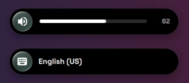

# Island

The Dynamic Island's on-screen display, for any Ryoku bar style.

Volume, microphone, brightness and keyboard changes appear as a black pill that springs out from the top edge, the way the island grows. The glyph sits in a well of liquid glass. The level is a white bar that greys out when muted. With volume boost on, the part past 100 % shows in your accent. A keyboard change shows the layout name and no bar.

Install it from RyoStore → On-screen displays, then pick it in Settings → Overlays.

## What it runs, reads and writes

Nothing. It draws the values the shell hands it. No processes, no files, no network.

`GlassControl.qml` draws the glass with `shaders/liquidglass.frag.qsb`, a compiled Qt shader. The GLSL source is next to it in `shaders/liquidglass.frag`.

From [quickshell-DynamicIsland](https://github.com/Alan-Betty/quickshell-DynamicIsland) by Alan Betty. MIT licensed. Report problems upstream.
