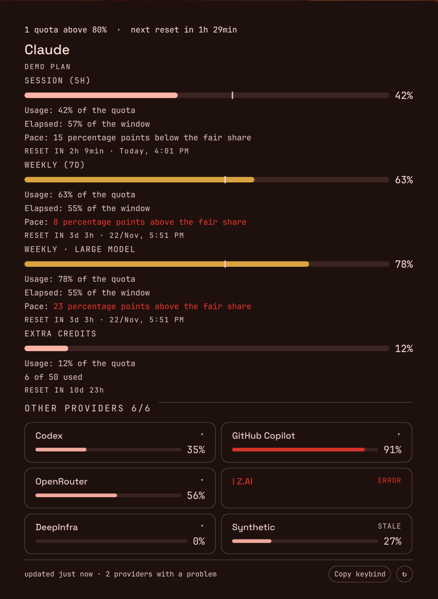
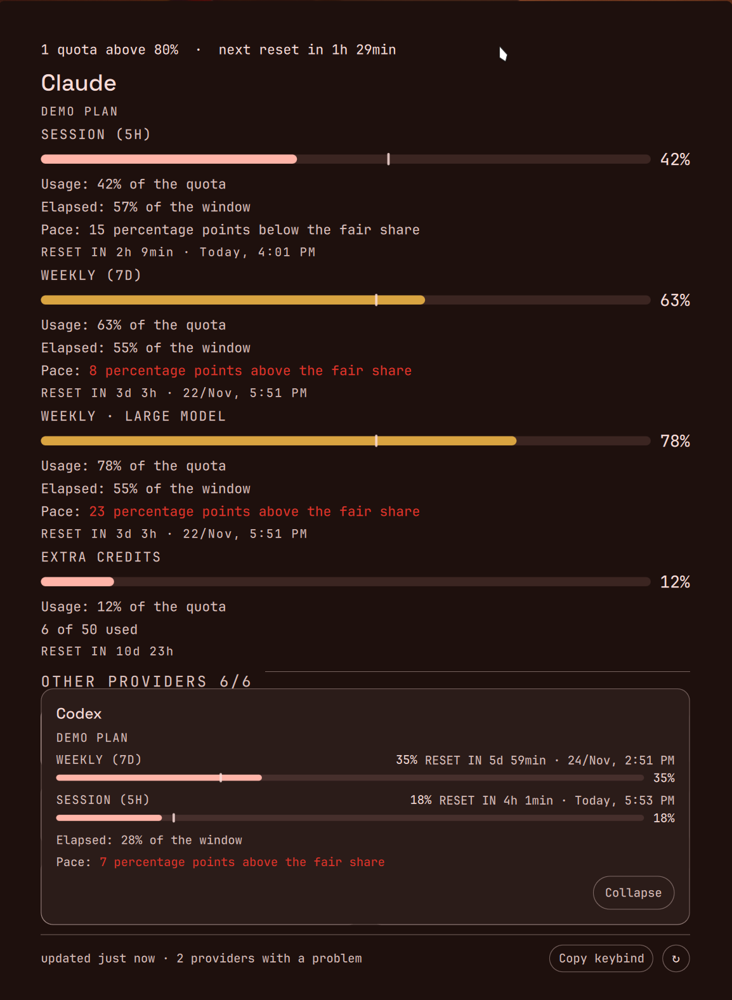

# AI Usage

Your AI plan quotas on the Ryoku desktop, at a glance.



`AI Usage` (`ai-usage`) is a community plugin for the [Ryoku](https://github.com/ryoku-dev/ryoku)
shell. It reads your AI usage from one of two local sources — the
[`ai-usagebar`](https://github.com/akitaonrails/ai-usagebar) report, or the
cache files Ryoku's own built-in AI usage monitor already keeps for the QS Bar
widget — and shows, for **every** quota of every provider: how much is used, how much of its time window has elapsed, and
whether you are ahead of or behind the fair share — a vertical tick on each bar
marks elapsed time, so the deviation is visible without reading a number.

Both images on this page are real captures of the popout fed with a made-up
report: the providers are real products, every number and plan name is invented.

## What it does

- **One line of operational summary** at the top: how many quotas are exhausted,
  how many are above 80%, and when the next reset happens.
- **A meter per quota**, coloured by severity: neutral below 60%, amber from 60
  to 84%, red at 85% and above. The colour reinforces the number; it never
  carries the state alone.
- **Three separate readings per quota** — `Usage`, `Elapsed`, `Pace` — instead of
  one ambiguous sentence. A quota whose window length is unknown shows no pace at
  all, because there is nothing honest to compute.
- **The primary provider, in full**, with every one of its quotas. Providers that
  share a name but not an account are told apart by the account, shown only when
  the label would otherwise be ambiguous.
- **Every other provider as a pill**, laid out in a grid of 2 to 4 columns. Each
  pill carries the provider's name, the bar of its most-used quota, and that
  quota's percentage — so a glance at the grid is already the answer, and the
  popout width grows with the column count you choose.
- **A drawer with the full detail**, opened by clicking a pill. It shows every
  quota of that provider: label, percentage, reset, and the elapsed/pace
  readings. One drawer at a time — opening another closes the first.
- **A footer** saying when the data was last read, a refresh button, a copy
  button for the keybind command, and how many providers have a problem.



## Install

- **Ryoku Settings -> Plugins -> Discover -> AI Usage -> Install**, then enable
  it on the **Frame popout** host.
- Or straight from git:

  ```sh
  ryoku plugin add https://github.com/danmaxis/ryoku-ai-usage-widget
  ```

**Data source.** The plugin needs one of two sources, and never talks to a
provider itself. With the default setting, `Auto`, it picks for you:

1. [`ai-usagebar`](https://github.com/akitaonrails/ai-usagebar), when it is on
   your `PATH`. It covers the most providers (Claude, Codex, Copilot,
   OpenRouter, Z.AI and many more) and owns all of its own collection,
   credentials and network access.

   ```sh
   paru -S ai-usagebar-bin
   ```

2. Otherwise, **Ryoku's built-in AI usage monitor** (`ryoku-ai-usage`, part of
   Ryoku itself) — the same one that feeds the AI usage widget of the QS Bar.
   Nothing to install: it already runs on a 5-minute timer and writes
   `claude-usage.json`, `codex-usage.json` and `opencode-usage.json` to your
   cache directory, one per agent you have installed. It covers Claude Code,
   Codex and OpenCode only.

You can force either one in the settings. The two are never mixed in one
report, and the footer of the popout says which one the numbers came from. With
neither available the popout does not fail silently: it says so and names both
ways out.

**Opening it with a key.** The plugin does not bind a key for you: a store
plugin may not touch the window manager or your keybind files. In
**Ryoku Hub -> Keybinds**, bind:

```sh
ryoku-shell plugin ai-usage
```

This is a **toggle**: the same key that opens the popout closes it. The popout's
footer has a **copy button** for this exact command, so you do not have to
retype it.

**Window managers.** The plugin contains no compositor code and reaches the
desktop only through the shell. It was built and tested on Hyprland; it has
**not been tested on niri**.

## How it plugs in

The shell owns the surface, its placement and its motion. This plugin ships:

- `service/Main.qml` - persistent, non-visual logic: runs the collector on a
  timer and holds the last report. (`main` entry point.)
- `content/Widget.qml` - the one view, drawn at `full` density in the
  `framePopout` host. (`content` entry point.)
- `bin/ai-usage-collect` - a Python script that turns the `ai-usagebar` report,
  or Ryoku's AI usage cache files, into the model the view draws.
- `content/i18n/*.json` - the plugin's own translation catalogues.

**Runs.** The bundled `bin/ai-usage-collect` script. With the `ai-usagebar`
source it invokes exactly one external program:

```text
ai-usagebar usage --json
```

With the Ryoku source it runs nothing at all: it does not start Ryoku's
collectors or its timer, it only reads what they already wrote.

**Reads.** One of the two, never both:

- the local `ai-usagebar` JSON report (schema version 1): provider names,
  plans, status, metrics, percentages, reset instants, window lengths and
  upstream-provided detail;
- or the three cache files of Ryoku's AI usage monitor, read-only:
  `~/.cache/claude-usage.json`, `~/.cache/codex-usage.json` and
  `~/.cache/opencode-usage.json` — utilization fractions, reset instants,
  window lengths, the plan label and the modification time of each file.

Key-like fragments inside plan labels are redacted before they reach the
screen. The plugin never opens a credentials file.

**Writes.** No files. The plugin has no state of its own: no config file, no
cache, no receipt. Its collector is pure stdout. Settings live in Ryoku's own
`plugins.json` and are written by the shell, not by the plugin.

One exception, and only when you ask for it: the **copy button** in the footer
puts `ryoku-shell plugin ai-usage` on the clipboard. Nothing is copied unless you
click it.

**Network.** None of its own. Whatever `ai-usagebar` does is its own business and
is declared there.

**Commands.** Arguments are always passed as an argv array — never through a
shell (`sh -c`), so a value from settings cannot become a command. Changing a
setting cancels the read in flight; the collector then stops `ai-usagebar` and
anything it started before it exits, so no orphan is left waiting on a stalled
network. For the case where the collector itself is killed outright — the
shell does that when the plugin is unloaded or the shell reloads — the
collector leaves a guardian behind: a fork of itself that only watches, stops
`ai-usagebar` when its parent is gone, and exits as soon as there is nothing
left to guard.

## Settings

| Key | Setting | Options / range | Default | Effect |
| --- | --- | --- | --- | --- |
| `language` | Language | Auto, English, Español, Français, Português, Português (BR) | English | UI language. `Auto` follows your session locale. A missing translation falls back to the English string, never to a blank. |
| `accent` | Accent | Wallpaper, Brand, Monochrome | Wallpaper | Accent token for the neutral band of the meter scale. Amber and red are fixed: a red accent can never make low usage look alarming. |
| `source` | Data source | Auto, ai-usagebar, Ryoku built-in | Auto | Where the numbers come from. `Auto` uses `ai-usagebar` when it is installed and Ryoku's built-in monitor otherwise. The two are never mixed. |
| `order` | Provider order | Upstream primary, Highest headline %, Lowest headline %, Alphabetical, Manual sequence | Upstream primary | Which provider becomes the primary card, and the order of the pills. |
| `orderSequence` | Manual sequence | comma-separated ids | *(empty)* | With `Manual sequence`: ids in the order you want, e.g. `anthropic,openai@work`. The first ready one becomes the primary. |
| `primary` | Pinned provider (exact id) | a report id | *(empty)* | Forces one provider to be the primary, in **any** order mode. Takes precedence over the chip below. A pinned provider that is in error does not become primary — the next healthy one does, and the pinned one is still listed. |
| `primaryChoice` | Pinned provider — all order modes | Auto, Anthropic, OpenAI, GitHub Copilot, OpenRouter, Synthetic | Auto | Same effect, by chip. `Auto` pins nothing. Beware: a chip cannot name an account, so `OpenAI` does **not** match a provider reported as `openai@work` — use the text field for that. |
| `showMetricDetail` | Show primary pace detail | On / Off | On | Shows the derived `Elapsed` and `Pace` lines. Never hides `Usage`, which is the datum the plugin exists to show. |
| `padding` | Padding | 0–32 | 12 | Inner spacing. |
| `gap` | Row gap | 2–24 | 6 | Spacing between sections. |
| `columns` | Columns | 2–4 | 2 | How many pills per row. The popout widens to fit; it does not squeeze the pills. |
| `drawerDirection` | Drawer direction | Down, Left, Right | Down | Where the detail panel opens. A side drawer falls back to `Down` when the popout is too narrow for it. |
| `drawerMaxHeight` | Drawer max height | 160–480 | 320 | Ceiling of the drawer, in logical pixels (scaled by your UI scale). It never claims more than 60% of the tallest screen, and with `Down` never more than fits on the screen the popout is on. |
| `secondaryLabel` | Secondary label | Name, Short code, Plan | Name | Label used inside the pills and in the drawer header. |
| `showSecondaries` | Show secondary pills | On / Off | On | Shows or hides the grid of pills. |
| `maxSecondary` | Secondary pills | 0–12 | 6 | How many secondary providers the grid draws. |
| `pollSeconds` | Every (s) | 60–3600 | 300 | Report polling interval. The upstream caches, so aggressive polling is waste. |
| `keybindHint` | Keybind | *(free text)* | *(empty)* | Reminder of the command to bind. Display only — the shell verifies nothing typed here. |

Settings are declared as the `metadata.settings` schema in `manifest.json`; the
shell renders the form and persists the values.

Ordering never recomputes the upstream's numbers: it sorts by the percentage each
provider reports and keeps providers with a usable percentage ahead of ones in
error or without metrics; ties keep report order.

## Honest limitations

- **The popout is not transparent.** The background belongs to the host shell,
  not to the plugin, and there is no plugin-side way to change it. A request is
  filed upstream.
- **The Ryoku source knows three agents, and one of them is an estimate.**
  Ryoku's built-in monitor reports Claude Code, Codex and OpenCode — nothing
  else. Claude and Codex are real quotas read from their servers. OpenCode has
  no quota at all: its percentage is measured against a cap the Ryoku collector
  made up, so the plugin labels it `local estimate`, writes its percentage
  with a `~`, keeps it out of the "exhausted / above 80%" summary, and shows no
  reset, no `Elapsed` and no `Pace` for it — there is no window to be ahead of
  or behind.
- **The Ryoku source is as fresh as Ryoku's timer.** The plugin only reads the
  cache files; it never asks for a new collection. The numbers can be up to 5
  minutes old, the refresh button re-reads the files without making them newer,
  and a file older than 15 minutes is marked as stale.
- **The cleanup after a cancel has two edges.** A cancelled or killed read
  takes `ai-usagebar` down with it, by process group. A program that moved
  itself into a session of its own would escape that, and so would anything
  left running if the collector and its guardian were both killed in the same
  instant. `ai-usagebar` does neither.
- **An estimate never outranks a real quota.** With `Highest headline %` or
  `Lowest headline %`, a provider whose numbers are an estimate is ordered
  after every provider with a real quota, whatever its percentage.
- **`0%` and "no data" are different things, on purpose.** A quota at 0% draws an
  empty bar and says `0%`. A quota without a percentage draws no bar at all and
  says `—`.
- **"Exhausted" and "above 80%" are absolute thresholds**, not pace-aware. A
  quota at 89% of a window that is already 80% elapsed is painted red, even though
  the upstream's own severity field calls it merely high — the upstream weighs
  elapsed time, this plugin's summary does not. Colour follows the percentage.
- **The drawer does not scroll, and it says so.** Parts of a provider that do not
  fit under `Drawer max height` are cut from the end and announced as `+N more` —
  in plain text, not as a button, because there is nothing to click: the ceiling
  is the answer, not a teaser. If you need more, raise the height in settings.
- **A side drawer turns into a bottom one when the width does not allow it.**
  `Left` and `Right` keep the popout from growing in height, but they have to eat
  horizontal room from the grid, and the plugin refuses to shrink the columns you
  chose or to flip sides in silence.
- **With `Down`, a drawer that has no room below rises over the content.** The
  popout is sized to its content and the host clips whatever exceeds the screen,
  so the drawer never grows the popout past it: when there is not enough room
  under the grid it opens upwards from the base, covering the pills and, if it
  needs more, the last lines of the primary provider until you collapse it. The
  footer and the collapse button stay visible. With room to spare it pushes the
  content down instead, as before. `Left` and `Right` are unaffected.
- **When a drawer is cut, the counter and the way out are never what gets cut.**
  `+N more` and the collapse button are reserved first, metrics take what is
  left, and the `Elapsed` and `Pace` lines give way before any of them.
- **The screen limit is an estimate.** The host does not tell a plugin how much
  height it has. The plugin reads the height of the screen it is on and keeps a
  fixed reserve for the bar and the frame, measured on the default Ryoku layout.
  A taller bar or a custom frame can still clip a few pixels.
- **The pills and the collapse button are not keyboard operable.** A plugin
  popout runs in the shell with `keyboardFocus: None` (`FrameMenuManager.qml`),
  so no plugin can hand it focus. Clicking works; `Tab` does not. This is a
  limitation of the host, not of this plugin.
- **A pinned-provider chip cannot name an account.** The chips are the bare
  vendor ids, and `--primary openai` does not match a provider the upstream
  reports as `openai@work`. Use the `Pinned provider (exact id)` text field for
  those; it takes precedence over the chip.
- **The pin warning is English only.** It lives in the manifest, and the manifest
  is not translated by the plugin's own catalogues.
- **The drawer is not remembered between openings**, and no setting is written
  from the popout: the frame popout host gives the view an API without
  `saveSetting`, only a no-op `saveSettings`. A drawer that stays open across a
  poll stays because the provider is still there — never because it was saved.
- **The timer stops when the popout is closed.** Countdowns and the "updated N ago"
  line tick only while the surface exists. Reopening re-reads the report — the
  view asks for a refresh on mount when the data is older than 30 seconds.

## Languages

English is the source of truth: UI strings are the English text itself, so an
untagged string is never broken. Translations ship for Español, Français,
Português and Português (BR). Adding a language means adding
`content/i18n/<code>.json` with the same keys — anything untranslated falls back
to English.

Translations live in the plugin because a plugin may not import the shell's own
i18n module (R4) and may not read `shell.json` (R5). The language is chosen by the
setting above, not by the shell's global language.

## Privacy

This is a community plugin (`official: false`). It contains no account data, no
credentials and no compiled binaries. It reads one local source — the
`ai-usagebar` report or Ryoku's AI usage cache files — and writes nothing.

## Develop

```
ai-usage/
  manifest.json              # id, version, entry points, host, settings schema
  service/Main.qml           # main: polling, collector process, last report
  content/Widget.qml         # content: the popout view
  content/i18n/*.json        # en, es, fr, pt, pt_BR
  bin/ai-usage-collect       # collector: ai-usagebar or Ryoku caches -> view model
  assets/preview-popout.png  # the README images
  assets/preview-drawer.png
```

The plugin follows the rules `ryoku plugin validate` enforces:

```sh
ryoku plugin validate .
```

The test suite is not shipped in the store folder. It lives in the upstream
repository, <https://github.com/danmaxis/ryoku-ai-usage-widget>: behavioural
harnesses that mount the real view in an offline `quickshell`, plus unit tests
for the pure functions (the reset-time formatter, the colour scale, the summary
arithmetic). Bug reports and fixes go there too.

## Credits

Written and maintained by Danilo Heroso <danmaxis@gmail.com>, not by the Ryoku
team. Usage data comes from [`ai-usagebar`](https://github.com/akitaonrails/ai-usagebar)
or from the AI usage monitor that ships with [Ryoku](https://github.com/ryoku-dev/ryoku)
(`ryoku-ai-usage` and its `claude-usage`, `codex-usage` and `opencode-usage`
collectors).
MIT-licensed - see `LICENSE`.
