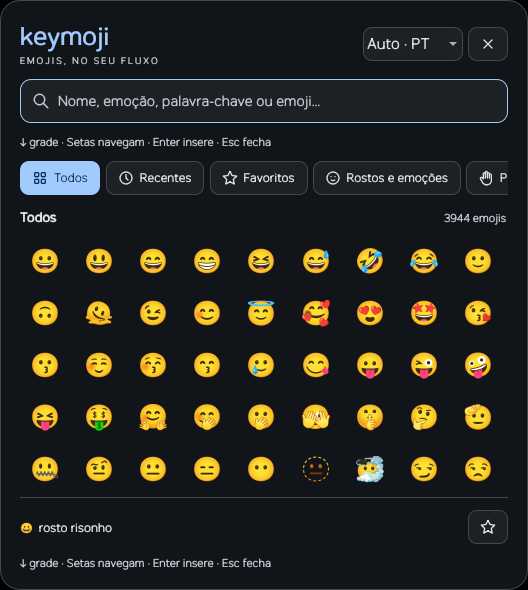

# Keymoji

Offline emoji keyboard with localized search and insertion into the original text field. Community plugin maintained by Eduardo Augusto.



## What it does

- Searches 3,944 Emoji 17.0 sequences by localized names and keywords, multiple terms, emoji or Unicode code points; ignores accents and tolerates simple typos.
- Focuses search when opened, remembers the originating window and releases the keyboard before insertion through wtype. Does not modify the clipboard.
- Supports arrow navigation, visible selection, automatic scrolling, Home/End, PageUp/PageDown and Enter to insert the selected result. Typing returns to search; left/right still edit a non-empty query before entering the grid.
- Keeps local favorites and 48 recent sequences. Skin tones, flags and ZWJ sequences are preserved.
- Closes with Escape while search has focus, the close button or an outside click. Input capture is removed immediately, independently of the exit animation.
- Follows Ryoku named/wallpaper colors and the effective native compositor animations, animation master, motion tempo, reduce-motion and low-power preferences.

## Install

After catalogue publication, install from Ryoku Hub → Add-ons → Plugins, then enable Keymoji on the QS Bar. From a reviewed checkout:

```sh
ryoku plugin validate plugins/keymoji --allow config-write
ryoku plugin add "$PWD/plugins/keymoji" --bar --yes --allow-findings
```

The local Ryoku validator flags the read-only shell.json lookups as config-write. Theme.qml reads palette and Localization.qml reads desktop language; neither writes Ryoku configuration. The language preference writer targets only the plugin’s own state directory; review that specific finding before using the explicit local exception. No security policy/scanner exceptions are added by this submission.

Requires qs (Quickshell), wtype, bash, dirname, mkdir, env and ryoku-hub; Noto Color Emoji is recommended. The compositor must support layer-shell, foreign-toplevel management and virtual-keyboard. Launch from the QS Bar mark → Open keyboard, or bind the installed bin/keymoji with KEYMOJI_STATE_DIR set to the plugin's state directory. The standalone keyboard lives in its own layer-shell so the bar host does not dictate input focus.

## How it plugs in

Host: topbarGlyph. The PluginKit-themed glyph opens a native panel with a launch button. The keyboard is Qt Quick/Quickshell; there is no browser, server, Electron bundle or runtime JavaScript dependency installation.

The app executes its local launcher and qs/wtype; it never runs privileged commands or contacts the network. It reads only the bundled catalogue, Wayland window state, and Ryoku theme/motion files. The launcher passes pluginApi.stateDir as KEYMOJI_STATE_DIR. Favorites/history are written only there. No clipboard or application text is read. Removing history.json clears local usage data.

The first outside click dismisses the panel and is not forwarded to the application behind it. Once dismissal begins, the empty input region permits subsequent clicks immediately, and the client surface unmaps immediately and the compositor owns any exit snapshot. Search releases focus before requesting activation of the remembered window; a changed destination cancels insertion.

Escape is handled directly while the search field owns focus. Closing by Escape while the keyboard is in pointer-only mode requires a desktop shortcut sending IPC hide; this PR does not install/edit compositor keybinds. The local development workspace used an explicitly configured, non-consuming Escape binding. On other desktops, configure this using their supported shortcut UI.

## Settings

No plugin settings are added. Colors are read from theme.json, shell.json/themePalette and colors.json; changes are watched. Opening/closing is rendered solely by the compositor, following its effective styles, Bézier/spring curves, inherited settings and separate layer fade channels; no extra QML reveal, offset or fade is applied. Internal transitions refresh the effective registry via ryoku-hub desktop defaults on open and watched configuration changes, and apply performance.json preferences. Without that registry, internal timings fall back to persisted settings. A curve merely selected in the editor is not necessarily assigned to a desktop animation.

Outside Ryoku, built-in colors/motion provide fallbacks. Font emoji coverage depends on the system font. wtype success means events were submitted, not that every client accepted them: Chromium/Electron and XWayland interoperability still needs application-specific testing. There is no silent clipboard fallback.

## Develop

```sh
cd plugins/keymoji
bun test
```

app/ contains the window, theme/motion readers, SVG icon component, search and keyboard-navigation helpers. service/ and content/ implement the PluginKit host. bin/keymoji launches/toggles via IPC. tests/ has 25 Bun tests for catalogue/search, insertion guards, theme precedence, motion and navigation. Bun is development-only.

See docs/validation.md for live coverage and remaining compatibility checks. The preview is an actual Qt render, not a mockup. The product manifest records hashes, sizes and permissions; development tests/package metadata are not installed.

## Credits

MIT code, with the original hypruser catalogue notice retained in LICENSE. Portuguese annotations originate from Unicode CLDR, supplied through the existing MIT emoji-ptbr catalogue; see docs/data.md and docs/UNICODE-LICENSE.txt. This does not redistribute Emojipedia editorial text, vendor artwork or branding. Tabler SVG icons are vendored with their MIT licence and exact revision in app/icons/. Maintainer/contact: Eduardo Augusto, via the linked upstream fork. This is not an official Ryoku product.

## Language and search

Choose Auto, Português, English, Español or Français in the keyboard header. Priority is the saved Keymoji preference, then Ryoku’s shell language, then the process locale (LC_ALL, LANGUAGE, LC_MESSAGES, LANG, Qt), with English fallback for unsupported locales. Auto restores the environment default. The preference is stored in settings.json under the plugin state directory; the QS Bar panel watches the same preference. The app never changes the environment language.

Each bundled CLDR locale has names/keywords for all 3,944 sequences. The active locale drives interface labels, categories, emoji names and keyword ranking. English terms remain a search fallback. Accent/ligature folding supports queries such as coracao, corazon and coeur. Stable category IDs and Unicode identities preserve filters, favorites and recents across locale changes. Revision and upstream source hashes are pinned in data/i18n/source.json; runtime remains entirely offline. Only English plus the selected locale are loaded, not every dictionary.
