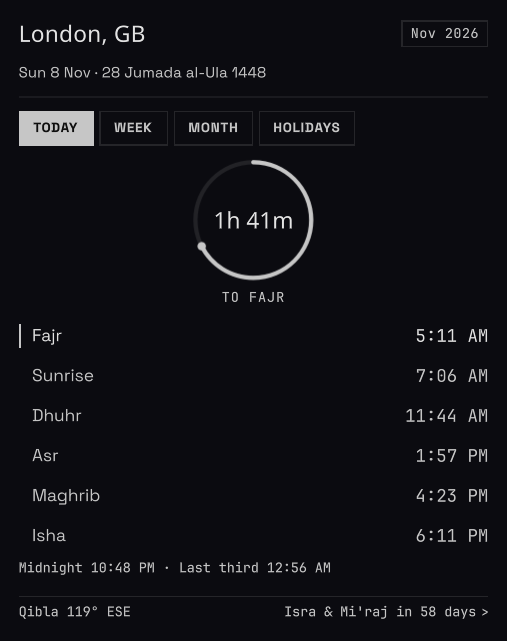

# Prayer Times

Local prayer times, Hijri dates, Islamic holidays and Qibla for the Ryoku QS Bar.




## What it does

- Shows the next prayer and a live countdown in the bar.
- Opens a panel with today's six prayer times, an animated progress ring carrying a
  second-precision countdown, night times, and Qibla with a pointing arrow.
- Seven-day and whole-month tables, Umm al-Qura Hijri dates, and the next six
  Islamic holidays with day counts.
- 45 preset cities and nine calculation methods (MWL, ISNA, Egyptian, Karachi,
  Umm al-Qura, Dubai, Diyanet, Southeast Asia, Russia). Each preset defaults to
  the convention that country actually uses.
- Honest about its own limits: a timezone no preset covers says so instead of
  quietly showing another city's times, and a date with no twilight says that
  instead of printing six dashes.
- A Node CLI and a Waybar module example.

## Accuracy

The maths is the PrayTimes.org algorithm, but solved properly: every event is
solved with the sun where it actually is at that moment, not once for the whole
day. Sampling once a day is what most implementations do, and it leaves the
horizon events up to two minutes late at mid latitudes — by the time the sun
reaches the angle, the declination has already moved.

`tests/engine-test.js` checks three things:

1. **The sky.** An independent ephemeris computes the sun's altitude at the times
   this engine reports; every Fajr, Sunrise, Maghrib and Isha must land within 45
   seconds of the true crossing of its angle. That is the real gate: it fails if
   the maths drifts, whatever a reference app happens to print.
2. **A reference implementation.** 23 canned AlAdhan responses across eight
   methods, five cities, a DST boundary and both polar cases, within one minute
   (two for Asr, where this engine's per-event sampling is deliberately more
   precise than the reference's once-a-day sample). One fixture pins the
   high-latitude angle rule against AlAdhan's own default at Stockholm midsummer.
3. **The calendar.** Every one of the 1,896 months in the embedded Umm al-Qura
   table is walked and round-tripped, with 1420 AH onwards required to be 29 or 30
   days. The Islamic holidays are pinned to AlAdhan's Umm al-Qura conversions.

## Install

```sh
ryoku plugin add <git-url> --bar --yes
```

## Settings

| Key | Type | Default | Description |
| --- | --- | --- | --- |
| `city` | choice | `auto` | Preset city, or `auto` to detect from the system timezone. |
| `latitude` | text | `""` | Latitude override; empty uses the city. |
| `longitude` | text | `""` | Longitude override; empty uses the city. |
| `method` | choice | `auto` | Calculation method; `auto` uses the city's convention. |
| `asr` | choice | `standard` | Standard or Hanafi Asr calculation. |
| `highLat` | choice | `none` | What to do when the sun never reaches the twilight angle: `middle`, `seventh` or `angle`. |
| `offsetFajr` | int | `0` | Fajr adjustment in minutes, from -30 to 30. |
| `offsetSunrise` | int | `0` | Sunrise adjustment in minutes, from -30 to 30. |
| `offsetDhuhr` | int | `0` | Dhuhr adjustment in minutes, from -30 to 30. |
| `offsetAsr` | int | `0` | Asr adjustment in minutes, from -30 to 30. |
| `offsetMaghrib` | int | `0` | Maghrib adjustment in minutes, from -30 to 30. |
| `offsetIsha` | int | `0` | Isha adjustment in minutes, from -30 to 30. |
| `display` | choice | `full` | Bar content: `full`, `time` or `name`. |
| `clock24` | toggle | `false` | Use a 24-hour clock instead of AM/PM. |
| `hijriAdjust` | int | `0` | Shift the Hijri date by -1, 0 or 1 day. |

Above roughly 48 degrees of latitude the sun sometimes never reaches 18 degrees
below the horizon. On `none` those times are simply absent and the panel says so;
pick `angle` (the usual choice) or one of the night-fraction rules to fill them.
The rules only fill what the angle could not reach — they never invent a sunset.

A preset city in another timezone is rendered on your own clock, with the
countdown still correct; the panel says "Shown on your clock" so the converted
times do not look like a bug.

## Panel segments

Clicking the glyph opens a 380 px panel with four segments:

- **TODAY** - ring countdown to the next prayer, the six times, Islamic midnight,
  the last third of the night, Qibla bearing with a pointing arrow, and the next
  holiday.
- **WEEK** - the next seven days, one row per day, holidays dotted.
- **MONTH** - the whole month, today highlighted, holidays dotted, scrolling under
  a pinned header with a visible position bar.
- **HOLIDAYS** - the next six Islamic holidays with Gregorian date, Hijri date and
  a day countdown. Holidays within 30 days are marked in gold.

While the panel is open the clock ticks once a second so the ring counter runs;
collapsed, it wakes twice a minute.

## Command line

```sh
bin/prayer-times --text --city london --24     # Fajr 05:11 ... Isha 18:10
bin/prayer-times --json --city jakarta         # JSON, city convention applied
bin/prayer-times --waybar                      # waybar module JSON
bin/prayer-times --cities                      # every preset id
bin/prayer-times --method seasia --high-lat angle
```

`--city` works on that city's own clock (`--date` defaults to today there), so a
preset in another country prints that country's times. See `contrib/waybar/` for
the module snippet.

## Security and privacy

The plugin runs inside the shell process with your own privileges. What it can and cannot do:

- **No network.** No sockets, no `fetch`, no `curl`, no telemetry — the times are pure arithmetic.
- **No file writes.** Nothing is stored on disk; settings live in Ryoku's own plugin store.
- **No shell.** The only external command is `readlink -f /etc/localtime`, run once as an argv array (never through a shell) to guess the city.
- **No dynamic code.** No `eval`, no `new Function`, no QML created from strings.
- **Plain text only.** Nothing is rendered as rich text or HTML, so a setting value cannot inject markup.
- **Settings are range-checked.** Latitude, longitude, per-prayer offsets and the Hijri shift outside their valid ranges fall back to defaults instead of feeding nonsense into the maths.
- **No dependencies.** Zero npm packages, so there is no supply chain to compromise.

CI pins both GitHub Actions to commit SHAs, runs with `contents: read`, and fails the build if a network, shell or `eval` call ever appears in the shipped code.

## Credits

- Prayer algorithm: PrayTimes.org.
- Umm al-Qura table: [dralshehri/hijri-converter](https://github.com/dralshehri/hijri-converter), MIT.
  The upstream copyright and permission notice is reproduced in `lib/hijri.js` (the
  store does not install README/LICENSE for plugins, so the notice ships with the module).
- City coordinates: OpenStreetMap.

## Licence

MIT
