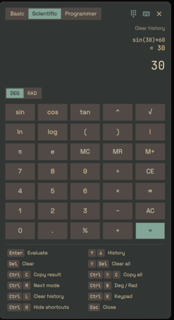

# QuickCalc

A fast, keyboard-driven calculator for Ryoku: type the expression, read the
live result, press Enter. Basic, Scientific and Programmer modes, in a bar
panel or a floating window, toggled by one keybind.



## What it does

Three modes, switchable from the tabs at the top, with Ctrl+M, or from
Settings:

- **Basic** -- the four operations, parentheses, percent.
- **Scientific** -- trig (`sin cos tan asin acos atan sinh cosh tanh`,
  degrees or radians; in degrees `sin(180)` is exactly 0 and `tan(90)` is a
  domain error), `ln log log2 sqrt cbrt exp abs floor ceil round trunc
  sign`, `^` for power, `!` for factorial, `pi`/`e`, and a one-slot memory
  (`MC` `MR` `M+`).
- **Programmer** -- a 32-bit signed integer calculator. A HEX / DEC / OCT /
  BIN readout shows the current value in every base at once; the highlighted
  row is the base you type and read in (click a row, or Ctrl+B, to switch).
  Bare digits are read in that base (`FF` in HEX, `101` in BIN); `0x1F`,
  `0o17`, `0b101` prefixes always work, in any base. Shifts are operators
  (`1<<4`, `x>>2`); the other bitwise helpers are functions: `and(a,b)`
  `or(a,b)` `xor(a,b)` `not(a)`. Results are truncated and wrapped to 32
  bits, so `0xFFFFFFFF` is `-1`. In the HEX base the letters `a`-`f` are
  digits, so a bare `e` (or `cafe`) is a hex number there, not Euler's
  number -- which would truncate to `2` anyway. Other names (`pi`, `ans`,
  your variables, `f(...)` calls) still work, and a variable named like a
  hex word wins over the digits.

Everything above is reachable by typing it -- the on-screen keypad (the
`showKeypad` setting, off by default) is an optional extra, not a
requirement. In Programmer mode it dims the digits the current base can't
take.

**Expressions**

- `ans` is the last result: `2+2` Enter, then `ans*10` Enter, gives `40`.
- After a result, typing an operator continues from it (`+1`), typing a
  number or name starts a new expression. Continuing uses the result's full
  precision: `1/3` Enter, `*3` Enter gives `1`, not `0.9999999999`.
- Implicit multiplication: `2pi`, `3(4+5)`, `(1+2)(3+4)`, `2sin(30)`.
- Variables: `x = 5*2` stores `x`; then `x^2`, `2x`. Built-in names (`pi`,
  `e`, `ans`, function names) can't be reassigned.
- `%` is always postfix "divide by 100" (`50%` is `0.5`, `100+10%` is
  `100.1`) -- the scientific-calculator convention, not the "percent of the
  other operand" convention of a retail till. Use `mod(a,b)` for the
  remainder; `log(x)` is base-10, `log(x,b)` is log base `b`.
- A trailing `=` is ignored, and pasted `×` `÷` `−` `π` `∞` are understood.

**Keyboard**

| key              | does                                              |
| ---------------- | ------------------------------------------------- |
| Enter            | evaluate                                          |
| Up / Down        | walk the history                                  |
| Del / Shift+Del  | clear the entry / clear the entry and `ans`        |
| Ctrl+C           | copy the result (copies the selection if there is one) |
| Ctrl+Shift+C     | copy the whole calculation, `expr = result`        |
| Ctrl+M           | next mode                                          |
| Ctrl+B           | next base (Programmer) / degrees-radians (Scientific) |
| Ctrl+L, Ctrl+L   | clear the history tape (press twice within 3 s)    |
| Ctrl+K           | show/hide the on-screen keypad (this session)      |
| Ctrl+H           | show/hide the shortcut panel (remembered)          |
| Esc              | close                                              |

Backspace, Left/Right, Home/End and text selection work natively -- it is a
real text field.

Everything is reachable by mouse too: the header has the mode switch and
buttons for the keypad, the shortcut panel and close; Scientific shows a
DEG/RAD switch; and every entry in the shortcut panel at the bottom is a
button that performs its shortcut. In the history tape, click an
expression to edit it again, or click a result to insert it.

## Install

**Ryoku Settings -> Plugins -> Discover -> QuickCalc -> Install**,
then enable it.

A fresh install is placed as a **Frame popout** (the floating window) in
the top-right corner, below the bar, in Basic mode with the keypad hidden
and the shortcut panel shown. Hovering the top of the right screen edge
shows a small *Open calculator* button; move the placer to the centre to
remove it. No keybind is set (see below). Choose the placement under
**Ryoku Settings > Add-ons > Show as**:

- **Bar** -- a calculator icon on the bar; click it (or press the keybind)
  and the calculator opens in a panel underneath.
- **Frame popout** -- used as the **floating window**: the keybind opens the
  calculator as its own floating surface, which stays open until Esc or the
  keybind (no hover, no timeout). It takes the keyboard while open and
  closes on Esc, the keybind, or a click anywhere outside it -- like the
  shell's Ask bar and launcher -- keeping your expression for next time. Its
  position is the Add-ons drag-and-drop placer: drop the chip on an edge,
  a corner, or the centre, and the window opens there.

**Keybind -- set it up once, by hand.** Installing the plugin does not add a
keybind: plugins can't register one, and they may not edit your compositor
config. One command toggles the calculator in either placement:

```
qs -c shell ipc call quickcalc toggle
```

`qs` is Quickshell's own command line (installed with the shell, already on
your PATH); this asks the running shell to toggle the calculator. To bind
it:

1. Open **Ryoku Hub -> Keybinds -> Custom** and add a new bind.
2. Pick the keys (for example Super + =).
3. Paste the command above as the action, and save.

Check it from a terminal first, if you like: running the command should
open the calculator, and running it again should close it.

## How it plugs in

The shell owns the host surfaces; this plugin ships:

- `service/Main.qml` -- all state and logic (expression, history, variables,
  memory, persistence, the IPC toggle). One instance, shared by every view.
- `service/Engine.js` -- the arithmetic: a pure JS parser/evaluator with no
  QML dependency.
- `content/Widget.qml` -- what each host mounts: the bar glyph
  (`topbarGlyph`), or the small open button inside the frame popout
  (`framePopout`).
- `content/Panel.qml` -- the bar panel; `content/FloatingWindow.qml` -- the
  floating window, a layer-shell surface (Quickshell's Wayland protocols, so
  it works on any compositor Ryoku runs); both host
  `content/CalculatorView.qml` (and `content/Keypad.qml`).

**Why "Frame popout" opens a window.** The shell's own frame popout, docked
to an edge, is a hover popout: opened by keybind it closes itself about
2.5 s after the pointer is not over it, even while you type, and a plugin
cannot switch that off. So the calculator never runs inside it. When the
pointer hovers that edge strip, the frame popout shows only a small
*Open calculator* button, which opens (or closes) the floating window. Put
the placer at centre and there is no hover strip at all.

Changing the placement reloads the plugin, so an open calculator closes;
press the keybind again.

The floating window's corners follow the shell's frame rounding (**Ryoku
Settings > Shell**), read through PluginKit; in Bar placement the shell
rounds the panel itself.

### What it runs, reads and writes

No network, no `sudo`/`pkexec`, no privileged action. It runs two external
commands, both declared in `dependencies.commands`:

- `wl-copy` -- Ctrl+C / Ctrl+Shift+C put text on the Wayland clipboard.
- `mkdir -p` -- creates its own state folder (below) once at startup.

It writes exactly one file,
`$XDG_STATE_HOME/ryoku/plugins/quickcalc/state.json` (by default
`~/.local/state/...`), holding the history tape, your variables and the
memory slot (and whether the shortcut panel is shown), so they survive a
shell restart. To wipe the history, press Ctrl+L twice, or click "Clear
history" above the tape twice (the first press only asks). To stop keeping
history at all, set **History entries kept** to 0. To reset
everything, delete the file and reload the shell. Settings are read through
the shell, never written from inside the calculator.

It reads nothing outside its own state folder besides its settings, which
the shell passes in.

## Settings

| key                | type   | default | description                     |
| ------------------ | ------ | ------- | -------------------------------- |
| layout             | choice | basic   | Basic / Scientific / Programmer  |
| showKeypad         | toggle | false   | Show the on-screen button grid   |
| angleMode          | choice | deg     | Degrees or radians for trig      |
| thousandsSeparator | toggle | true    | Group large results with commas  |
| precision          | int    | 10      | Decimal places shown             |
| historySize        | int    | 50      | History entries kept (0 = none)  |

Switching mode or angle unit inside the calculator lasts for the session;
the defaults above are changed from the settings page.

## Develop

```
quickcalc/
  manifest.json               # id, version, entry points, hosts, settings schema
  service/Main.qml            # main: state, persistence, IPC
  service/Engine.js           # pure arithmetic engine
  content/Widget.qml          # content: bar glyph / popout open button
  content/Panel.qml           # bar panel
  content/FloatingWindow.qml  # floating window (layer-shell surface)
  content/CalculatorView.qml  # the calculator UI
  content/Keypad.qml          # on-screen keypad
  tests/engine.test.cjs       # engine unit tests (node; development only)
  assets/preview-popout.png   # the README image and Store cover
  assets/preview-*.png        # Store gallery screenshots
```

The plugin never runs `tests/engine.test.cjs`; it is for development:

```
node tests/engine.test.cjs
ryoku plugin validate .
ryoku plugin add . --yes
```

## Credits

Written by Buxter <11074827+klopster@users.noreply.github.com>, my own work,
released under the MIT licence (see `LICENSE`).

This is a community plugin (`official: false`): it is maintained by its
author, not by the Ryoku team. Report bugs and requests to the author at
the address above (or through the upstream link on the Store page); I will
update it when Ryoku's shell or plugin API changes.
