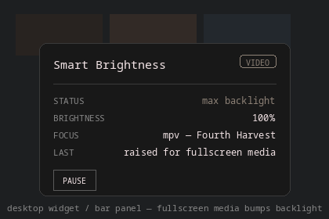

# Smart Brightness

Max the backlight for compositor-fullscreen media, then restore the previous
level when you leave — the SweetPotato / [fullscreen-maxbright](https://github.com/visnudeva/fullscreen-maxbright)
idea as a Ryoku plugin.



## What it does

When the focused window is **compositor fullscreen** and looks like a media
player or a video page (mpv, VLC, YouTube in Firefox/Chrome, Netflix, etc.), the
plugin raises the backlight to 100%. Leaving fullscreen restores the saved
level. It does **not** re-clamp while active, so the brightness keys still work
during a film. Strip-maximize alone never triggers it.

The watcher lives in `service/Main.qml` and stays alive while the plugin is
**enabled**. Default host is a **desktop widget** on the wallpaper (drag to
move, right-click for settings) — you do not need the QS Bar. An optional bar
glyph + panel is still available if you want it there too.

Detection uses Quickshell's `ToplevelManager` (foreign-toplevel), so it works on
Hyprland and niri without shelling out to a compositor CLI.

## What it reads and writes

| | |
| --- | --- |
| Runs | `bin/brightness` → `brightnessctl` (get / set / save / restore) |
| Reads | Focused toplevel `appId`, `title`, `fullscreen`; plugin settings |
| Writes | `$XDG_STATE_HOME/ryoku/plugins/smart-brightness/saved` (pre-max %) |
| Network | none |
| Privileged | none |

## Settings

| key | type | default | description |
| --- | --- | --- | --- |
| enabled | toggle | true | Master switch (also the panel TURN ON / OFF) |
| barLabel | choice | state | Nothing, or ON / VIDEO / OFF beside the mark |

## Install

```
ryoku plugin validate ~/Documents/ryoku-plugins/smart-brightness
ryoku plugin add ~/Documents/ryoku-plugins/smart-brightness --yes
```

It lands as a **desktop widget** (Settings → Add-ons → Plugins, or on the
wallpaper). Optional bar placement: `ryoku plugin add … --bar --yes`, then
**QS Bar Settings → Community**.

### Live edit (DEVELOP.md)

Point the shell at your authoring folder and restart once:

```
ryoku-host svc env RYOSTORE_PLUGINS_DIR="$HOME/Documents/ryoku-plugins"
ryoku-host svc --user restart ryoku-shell
```

Enable under **Settings → Add-ons → Plugins**. Edits to `content/*.qml` hot-reload
when you reopen the panel. Clear the override when done:

```
ryoku-host svc env RYOSTORE_PLUGINS_DIR=
ryoku-host svc --user restart ryoku-shell
```

## Credits

- Behaviour ported from SweetPotato `swirl/scripts/smart-brightness.sh` and
  `smart-brightness-lib.py`, themselves ported from fullscreen-maxbright.
- Author: Visnu <109976023+visnudeva@users.noreply.github.com> — community
  plugin (`official` is false).
