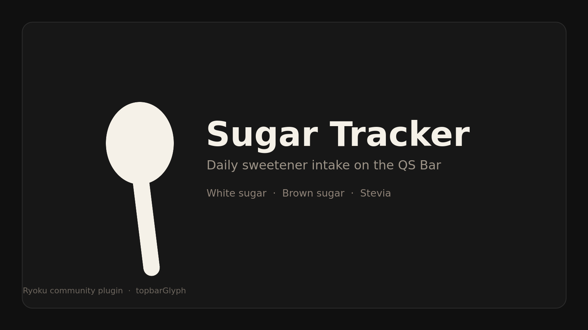

# Sugar Tracker



A Ryoku QS Bar plugin for recording daily sweetener intake in grams. Use its
panel to log ordinary white sugar, brown sugar, or stevia, add a custom amount,
convert an amount of white sugar into the brown sugar or stevia needed to match
its sweetness, review today's entries, and compare the total with your
configurable daily goal.

## What it does

- Shows a small spoon-only mark on the QS Bar, starting white at zero, turning green, then orange as you approach the goal, and red once you reach it.
- Expand Quick add to tap Sugar (white), Brown sugar, or Stevia. Set each
  amount in Ryoku Settings, or enter a custom amount.
- Expand Sugar equivalents, type an amount of white sugar, and see the brown
  sugar and stevia amounts that match its sweetness.
- Displays today's total, progress toward your goal, and the latest entries.
- Supports undoing the latest entry and clearing today's log.

The default 25 g goal is a configurable reference, not individualized dietary
advice.

## Install

From this directory, install and add it to the bar:

```bash
ryoku plugin add /path/to/sugar-tracker --bar
```

Replace the path with this plugin's directory. To install from Git instead, use
your repository URL. The plugin will appear in QS Bar Settings > Community;
Ryoku's plugin manager handles enabling and placement.

## How it plugs in

This is a community `topbarGlyph` plugin, implemented using Ryoku's standard
entry points:

- `service/Main.qml` holds today's log, total, persistence, and actions.
- `content/Widget.qml` renders the bar glyph and opens the panel.
- `content/Panel.qml` renders quick-add actions, the log, and goal progress.

Ryoku owns the bar placement, panel surface, and settings UI.

## Settings

| Setting | Default | Meaning |
| --- | ---: | --- |
| Daily sweetener goal (g) | 25 | Goal shown in the bar panel; change it in Ryoku Settings > Plugins > Sugar Tracker. |
| White sugar per tap (g) | 4 | Amount logged by the Sugar (white) quick-add button, the standard tap shown first. |
| Brown sugar per tap (g) | 4 | Amount logged by the Brown sugar quick-add button. |
| Stevia per tap (g) | 1 | Amount logged by the Stevia quick-add button. |
| Brown sugar grams per 100 g white sugar | 100 | Mass of brown sugar matching 100 g of white sugar. Brown sugar is sucrose with molasses, so 100 (the same mass) is the usual starting point; raise it if you find your brown sugar less sweet. |
| Stevia sweetness (× white sugar) | 200 | How many times sweeter the stevia you use is than sugar. Pure steviol glycosides are roughly 200–300×; a bulked stevia blend is often nearer 5–10×, so set this to match your product. |

The equivalents are a sweetness comparison, not a claim about calories or
health effects, and the plugin's daily total still counts the grams you
actually logged.

## Data and permissions

The plugin runs as part of Ryoku Shell with the user's permissions. It does not
run external programs or access the network. It reads and writes its own log at
`pluginApi.stateDir/sugar-log.json` (under Ryoku's per-plugin state directory).
Entries older than 14 days are discarded when the log loads. Quick-add amounts
are plugin settings managed by Ryoku. No other plugin or shell configuration
files are modified.

## Develop

```text
sugar-tracker/
├── preview.png
├── manifest.json
├── service/Main.qml
├── content/Widget.qml
├── content/Panel.qml
├── README.md
└── LICENSE
```

Validate with:

```bash
ryoku plugin validate .
```

## License

MIT — see [LICENSE](LICENSE).
