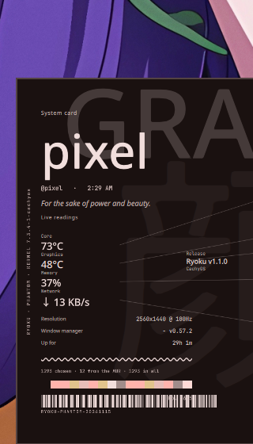

# System Card

Your machine printed as a poster on the wallpaper: the Ryoku Hub System Card,
ported to a desktop widget.



## What it does

The card is a 1280×800 poster of this computer, scaled to whatever size you
give the tile: the hero figure over the ground, your name and host, the
edition barcode, and live readings — core temperature and CPU load, graphics
load, memory, network rates, release — pinned to the figure by thin leader
lines. The epithets dissolve one into the next, a scan travels down the
figure, the signal wave runs off the load average, and the packages strip
shows how much of the system you chose yourself.

- **Specs** (dossier footer): resolution and refresh, window manager and
  version, uptime.
- **Memory** (the `mem` reading): live RAM usage percent over the installed
  total.
- **CPU** (the `core` reading): CPU temperature when a sensor answers,
  otherwise live CPU percent; the `Signal` wave follows the 1-minute load.
- Everything renders from the live palette, so the card follows your
  wallpaper theme like the rest of the shell.

## Install

```
ryoku plugin add . --yes
```

Enable it under **Ryoku Settings → Apps → Add-ons**; it lands as a desktop
tile. Drag to move, drag the corner bracket to scale, right-click for its
menu and settings.

## How it plugs in

- `service/Main.qml` — the data layer, the plugin's twin of the hub's
  `SysInfo` + `LiveStats`. It runs `bin/dossier` once a minute while the tile
  is mounted, `bin/poll` every `pollMs` (default 1500) while mounted, reads
  your `profile.json` hero settings (reloaded when Settings saves it), runs
  `ryoku-hub profile code` for the trading card's code rulers, and probes the
  root filesystem's creation time with `stat` for the install date. Nothing
  polls while the tile is unmounted.
- `content/Widget.qml` — the poster. The host sets `widthBudget`; the card
  draws at design size and scales to fit. All motion is gated on `active`
  and the `motion` setting.
- `content/Figure.qml` — the hero: the stock figure, or your own picture from
  Ryoku Settings → profile (`photo`, `mono`, or 1-bit Bayer `dither`). GIFs
  and videos fall back to the stock figure; a plugin does not play them.
- `content/Barcode.qml` — the Code 39 barcode and its small print.
- `bin/dossier` — runs the read-only `ryoku-sysinfo` and
  `ryoku-profile-stats` helpers shipped by Ryoku (searching
  `~/.local/bin`, `/usr/local/bin`, `/usr/bin`, then `PATH`); when a helper
  is absent or fails it falls back to direct `/proc`, `/sys` and
  `os-release` reads, with fields only the helpers answer (package counts
  included) printed as `-`.
  It never probes the compositor itself.
- `bin/poll` — one telemetry sample: two `/proc/stat` and `/proc/net/dev`
  reads 0.3 s apart give CPU percent and network rates; RAM percent and load
  average come from `/proc`; the CPU temperature from the `k10temp` /
  `coretemp` hwmon sensor or `thermal_zone0`; the GPU from `nvidia-smi`
  **only while every NVIDIA card is out of runtime suspend** (the probe never
  wakes one), or from amdgpu/i915/xe sysfs. A sample is shell builtins plus
  one `nvidia-smi` call.

## What it reads and writes

- **Runs:** `bin/dossier`, `bin/poll` (bash/awk/shell tools and the two
  read-only ryoku helpers above; `sensors` and `nvidia-smi` are optional and
  used only when present and awake), `stat -c %W /`, `ryoku --version`, and
  `ryoku-hub profile code` (hardware numbers in, the card code's tick levels
  out; no shell, every argument is its own argv entry). The trading card
  face needs a Ryoku Settings that has `profile code`; without it the card
  prints without the code rulers.
- **Reads:** `/proc/stat`, `/proc/meminfo`, `/proc/uptime`, `/proc/loadavg`,
  `/proc/net/dev`, `/proc/cpuinfo`, `/proc/sys/kernel/{hostname,osrelease}`,
  `/usr/lib/os-release`, `/var/lib/dbus/machine-id` (only hashed into the
  edition number, never shown),
  `/sys/class/thermal`, `/sys/class/hwmon`, `/sys/class/drm`,
  `/sys/bus/pci/drivers/nvidia`, `/sys/class/power_supply`,
  `~/.config/ryoku/profile.json`, `~/.config/ryoku/brand.json`, and
  `~/.config/ryoku/profile/hero.*` (your own picture). Every one of these
  reads is read-only.
- **Writes:** nothing of its own. No file, no setting outside `plugins.json`
  (through the host), no state directory. The first `ryoku-hub profile code`
  run makes Settings create its own device key file if it does not exist yet,
  exactly as opening Settings > About does.
- **Network:** none. **Privileged actions:** none.
- **Shown only:** the tile draws the local user's own card. It has no share,
  save, upload or badge feature, and it does not carry any card design other
  than the stock one and what Settings > About > Customise already saved on
  this computer.

## Settings

| key              | type   | default                     | description                          |
| ---------------- | ------ | --------------------------- | ------------------------------------ |
| name             | text   | (empty)                     | Big name; blank uses your username   |
| tagline          | text   | For the sake of power…      | Line under `@host · time`            |
| watermarkGlyph   | text   | 顔                          | Faint glyph behind everything        |
| epithets         | text   | Power,Beauty,Grace,…        | Comma-separated dissolving words     |
| marginalia       | text   | (empty)                     | Spine text; blank: codename + kernel |
| heroSide         | choice | right                       | Figure on the right or the left      |
| vitals           | multi  | core,gpu,mem,net,frac       | Which live readings to pin           |
| pollMs           | int    | 1500                        | Telemetry interval, ms               |
| motion           | toggle | true                        | Animate while mounted; with it on, hovering the tile tilts the card in 3D and the foils lock their sheen under the cursor |
| block… (9)       | toggle | true                        | Show/hide each block of the card     |

## Develop tree

```
manifest.json
service/Main.qml      data layer (dossier + live poll + identity files)
content/Widget.qml    the 1280×800 poster, scaled by widthBudget
content/Figure.qml    hero figure: stock, photo, mono, dither
content/Barcode.qml   Code 39 barcode
bin/dossier           helper runner / fallback, read-only
bin/poll              live telemetry one-shot, read-only
assets/caracalla.png  the stock figure
assets/preview-widget.png
```

## Credits

- Ported from the **Ryoku Hub** About page's System Card
  (`ryoku/hub/quickshell/components/about/`, hyperion branch), and follows
  its design: the card language, Lithic→themable palette, LiveStats and
  SysInfo data paths. This plugin is derivative work under GPL-3.0-only.
- Stock figure: "Caracalla MAN Napoli Inv6033 n01" by Marie-Lan Nguyen,
  CC BY 2.5, shipped in the Ryoku hub art as `profile-hero.png`.
- Community plugin: Ryoku does not review or maintain it.
